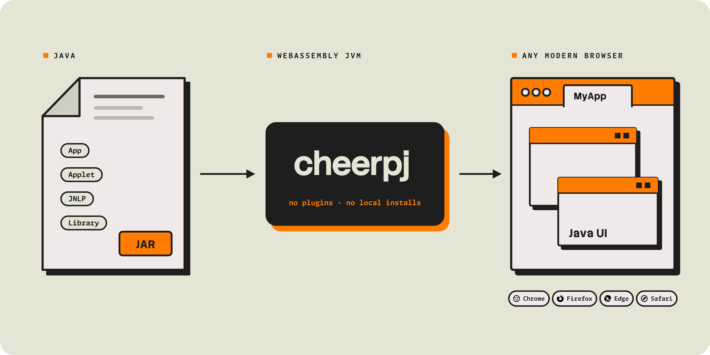

import { DISCORD_URL } from "@/consts.ts";
import JNLPRunnerButton from "@leaningtech/astro-theme/components/JNLPRunnerButton.astro";
import AppletRunnerButton from "@leaningtech/astro-theme/components/AppletRunnerButton.astro";
import Button from "@leaningtech/astro-theme/cheerpj-brand/Button.astro";

<div class="not-prose flex gap-2 mb-2">
	
	<a href="https://discord.leaningtech.com/">
		
	</a>
	<a href="https://github.com/leaningtech/cheerpj-meta/issues">
		
	</a>
</div>

<div class="text-lg">
	CheerpJ is a **Java Virtual Machine and a full build of OpenJDK for the
	browser**, implemented in WebAssembly and JavaScript. It runs Java
	applications, applets, Java Web Start applications and libraries from their
	compiled JARs, with no source code, recompilation, plug-in or local Java
	installation.
</div>

<div class="m-4 flex justify-center">
	[Get started](/docs/getting-started) · [Tutorials](/docs/tutorials) · [API
	reference](/docs/reference) · [GitHub
	repository](https://github.com/leaningtech/cheerpj-meta) ·
	[Licensing](/docs/licensing)
</div>

```html
<script src="https://cjrtnc.leaningtech.com/5.0/loader.js"></script>
```



## Choose your path

Each getting started guide takes one kind of Java program from its JARs to a running page:

- **Application:** a desktop Swing, AWT or console application
- **Applet:** an applet on a page you control, on Java 8
- **Library:** Java classes called from JavaScript or TypeScript
- **Java Web Start:** an application launched from a JNLP file

<div class="not-prose grid grid-cols-2 gap-4">
	<Button
		label="Application"
		variant="dark"
		size="lg"
		href="/docs/getting-started/Java-app"
	/>
	<Button
		label="Applet"
		variant="dark"
		size="lg"
		href="/docs/getting-started/Java-applet"
	/>
	<Button
		label="Library"
		variant="dark"
		size="lg"
		href="/docs/getting-started/Java-library"
	/>
	<Button
		label="Java Web Start"
		variant="dark"
		size="lg"
		href="/docs/getting-started/JNLP"
	/>
</div>

To run Oracle Forms or Oracle E-Business Suite, see [Oracle Forms](https://cheerpj.com/oracle-forms/) and [Oracle EBS](https://cheerpj.com/oracle-ebs/) on cheerpj.com.

## Quick start

You need your JAR files, an HTML page and a web server. Put the JAR in a folder with this `index.html`:

```html title="index.html"
<!doctype html>
<html lang="en">
	<head>
		<meta charset="utf-8" />
		<script src="https://cjrtnc.leaningtech.com/5.0/loader.js"></script>
	</head>
	<body>
		<script type="module">
			await cheerpjInit();
			cheerpjCreateDisplay(800, 600);
			await cheerpjRunJar("/app/my_application.jar");
		</script>
	</body>
</html>
```

Serve the folder and open `http://localhost:8080`:

```sh
npx http-server -p 8080
```

- [`cheerpjInit`](/docs/reference/cheerpjInit) starts CheerpJ. Its options choose the Java version, the clipboard mode, networking and more.
- [`cheerpjCreateDisplay`](/docs/reference/cheerpjCreateDisplay) creates the area of the page that holds the Java windows.
- [`cheerpjRunJar`](/docs/reference/cheerpjRunJar) runs the application, as `java -jar` does. For `java -cp … com.example.Main`, use [`cheerpjRunMain`](/docs/reference/cheerpjRunMain).
- `/app/` is the root of the web server the page comes from, as Java sees it. Forgetting the `/app/` prefix is the most common first mistake.

> [!warning] Use a web server
> Open the page over `http://` or `https://`, never `file://`. The server must support HTTP Range requests, which Python's `http.server` does not. See [server setup](/docs/guides/basic-server-setup).

<Button label="Get started" variant="primary" href="/docs/getting-started" />

## How CheerpJ works

1. **The page loads CheerpJ.** One script tag loads the JVM and the OpenJDK class library, from the CheerpJ CDN or your own web server. `cheerpjInit` starts the runtime and chooses the Java version.
2. **CheerpJ runs your bytecode as it is.** The JARs are read from your web server, in chunks, as the application needs them. An interpreter starts running the bytecode, and a JIT compiler turns the code that runs most often into optimised JavaScript.
3. **The application runs in the browser tab.** A window manager draws Swing and AWT windows with HTML elements and canvases. Files, networking, the clipboard, printing and audio go through browser APIs, inside the browser sandbox.

Nothing runs on a server: CheerpJ is a set of static files, and the application runs on the user's own device. [Architecture](/docs/explanation/architecture) explains each part, and [How CheerpJ works](https://cheerpj.com/how-cheerpj-works/) gives the overview.

## What CheerpJ supports

|                   |                                                                                                                                           |
| :---------------- | :---------------------------------------------------------------------------------------------------------------------------------------- |
| **Java**          | Java 8 (the default), 11, 17 and 21, with Java 25 in preview, chosen with the [`version`](/docs/reference/cheerpjInit#version) option     |
| **Language**      | The whole Java language and bytecode, including reflection, proxy classes, custom class loaders and obfuscated code                       |
| **Applications**  | Desktop applications, applets (Java 8), Java Web Start / JNLP applications, Oracle Forms and EBS, and libraries                           |
| **UI**            | Swing and AWT, with multiple windows                                                                                                      |
| **Files**         | [Virtual file systems](/docs/explanation/File-System-support) on your web server, in browser storage and in memory; uploads and downloads |
| **Networking**    | HTTP and HTTPS through the browser; TCP and UDP through [Tailscale](/docs/guides/Networking)                                              |
| **Desktop**       | [Clipboard](/docs/reference/cheerpjInit#clipboardmode), printing and audio                                                                |
| **Native code**   | [Native methods](/docs/guides/implementing-native-methods) in JavaScript or compiled to WebAssembly                                       |
| **Browsers**      | Chrome, Edge, Firefox and Safari, on desktop and mobile                                                                                   |
| **Not supported** | JavaFX, SWT, and pre-built native binaries (`.dll`, `.so`, `.dylib`)                                                                      |

The [compatibility page](https://cheerpj.com/compatibility/) has the full tables, including minimum browser versions.

## Try it

Write and run Java in the browser with [JavaFiddle](https://javafiddle.leaningtech.com/), which is built on CheerpJ:

<iframe
	src="https://javafiddle.leaningtech.com/N4IgLglmA2CmIC4QAlbWgewAQHcMCdoATXKACywGUcIA7AcxABoQBXAByIEMxYjEQAJgAMggMwBaAIzCJwgKwAVKQBYEqhPOEA6MVMEAtZiABmEOAGdEAbVDseZAQFkudbQCsuANy7GAxhi0vEECEAC27ARgWJ4+2lw4YNoAYoFgANwAOrThkfjRsVwAHtoWNAzaAFLJ+FxhsFk5EVEx3sWl5fRVADJcAEZojbkthSVldF2VAApctIPZw-mtPmOd2tQTAKqQ0FAQsBZDzUujHRPafQREsPjaAKIRYACeAEJXN43ZftBcFhZYLjoWFycHqQX+ACVWLRaP04FhgNksMisOxWH1dn4sBYwDwIFivBgICQwq5aAAKShgfATawAXSwXHw9AsAEoEUiUVyNgxtuY9gdtHRCQBrWC9Xj4clzHAAsnk1msxpcgC+2U5yLRGPxWEJxKw+GhCo5tC5XOmszQqKwAF4sDKsBa5tAFcqzZrSrAwG98NcpQ6Huxnj6-eSZEwsOHI8IIzJFZ9Te7Hb0BtAsGm7Q7Kim0OTMig0JgIwBhMiwG7sSoAQnzSo1ZugnrAqSC0tgspbYDzIEoNwgJnzEc72im3QAggBJAByEZUgnj9a57HiRCI5Ogddoi5R1Vq9SwJlt9vbjpqdVg3Z59CwsCKdXYcFrbvdJhXa-Ym6TB+09j8Itd27Iq+Fhet0GB+HigQQmgeJeLAigYNKrDoJ+SbAV6ABqEAWBAGIXtSrCwKhyJqrQpEgCqdIqkAA/embed?theme=dark"
	class="border border-stone-700 rounded-md w-full h-[40rem]"
></iframe>

More to try, with nothing to install:

- [Browsercraft](https://browsercraft.cheerpj.com/): the original Minecraft 1.2.5 client, running unmodified in a browser tab
- [Showcase](https://labs.leaningtech.com/showcase?product=CheerpJ): projects built with CheerpJ, such as FlatLaf, PhET simulations, ImageJ.js and Logisim
- [Tutorials](/docs/tutorials): complete examples, with their source in the [cheerpj-meta repository](https://github.com/leaningtech/cheerpj-meta/tree/main/examples)

## Not a developer?

The CheerpJ browser extensions run existing applets and Java Web Start applications in Chrome and Edge, with no changes to the page and no Java installation. They need no technical knowledge to install, and IT departments can deploy them with Group Policy. See [CheerpJ extensions](https://cheerpj.com/extensions/).

<div class="items-center justify-center space-y-4 sm:flex sm:space-y-0 sm:space-x-4 rtl:space-x-reverse">
	<AppletRunnerButton />
	<JNLPRunnerButton />
</div>

## Using a coding agent?

Install the [CheerpJ skill](https://github.com/leaningtech/skills). It covers converting `java` command lines, JARs, applets, JNLP files, Oracle Forms and libraries, and the common errors:

```sh
npx skills add leaningtech/skills --skill cheerpj
```

Or point your agent at [cheerpj.com/agents.md](https://cheerpj.com/agents.md) or [cheerpj.com/llms.txt](https://cheerpj.com/llms.txt).

## Licensing

CheerpJ is free for personal, educational and hobby use, and for technical evaluation by organisations of any size. One-person companies and non-commercial open-source projects can use it for free with a "Built with CheerpJ" credit. Business use needs a licence. See [licensing](/docs/licensing) for a summary and examples, and [cheerpj.com/licensing](https://cheerpj.com/licensing/) for the full terms and prices.

## Getting help

| Where                                                               | Best for                                                    |
| :------------------------------------------------------------------ | :---------------------------------------------------------- |
| [Discord](https://discord.leaningtech.com)                          | Questions, help getting started, and showing what you built |
| [GitHub issues](https://github.com/leaningtech/cheerpj-meta/issues) | Bugs in CheerpJ or the browser extensions                   |
| [Contact us](https://cheerpj.com/contact/)                          | Licensing, commercial support and enterprise deployments    |

Before you report a bug, read [debugging CheerpJ](/docs/guides/cheerpj-debug) and the [FAQ](/docs/faq). A good report names the CheerpJ version (from the loader URL), the Java version passed to `cheerpjInit`, your browser and operating system, and includes the full browser console output.

## Community

CheerpJ has been in production since 2017. Over a million people ran a CheerpJ application in the last 12 months, and the CheerpJ browser extensions have more than 170,000 users. It is used by NASA, Ticketmaster, Moody's, ADP and [many other organisations](https://cheerpj.com/customers/).

<div class="flex justify-end pt-4">
	<Button
		variant="plain"
		href="/docs/community"
		label="View community projects"
	/>
</div>

The CheerpJ team and community answer questions on Discord, where you can also share your projects.

<div class="not-prose flex flex-wrap gap-4">
	<Button
		variant="primary"
		href={DISCORD_URL}
		icon="fa-brands:discord"
		label="Join our Discord server"
	/>
	<Button
		href="https://github.com/leaningtech/cheerpj-meta"
		icon="fa-brands:github"
		label="Star us on GitHub"
	/>
</div>
