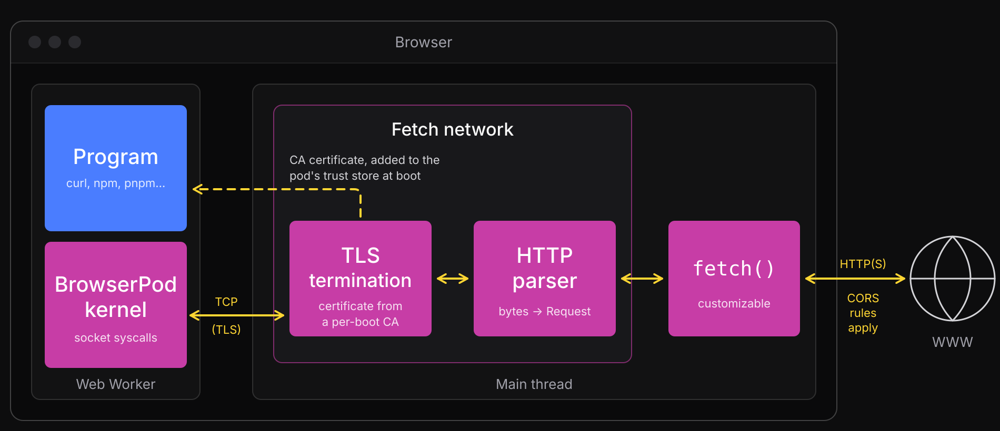

import BrowserPodProvider from "@leaningtech/astro-theme/components/blog/BrowserPodProvider.svelte";
import BrowserPodTerminal from "@leaningtech/astro-theme/components/blog/BrowserPodTerminal.svelte";

{/_ TODO: BrowserPodProvider, version="4.0.x", ideally with no apiKey so the post itself boots keyless.
Check that the component supports that. _/}

{/* TODO: hero demo. A small pod that shows at a glance what BrowserPod is. */}

Today we are releasing **BrowserPod 4.0**. TODO: intro. A relaunch: BrowserPod as a free library,
new licensing, new networking.

## What is BrowserPod

{/_ TODO: re-present from zero. Value proposition, purpose, audience
(AI agents and their builders; in-browser IDEs, playgrounds, docs and demos; platforms embedding dev tools).
Wording: "Linux applications in the browser", "Linux-like"; not "Real Linux". _/}

## What it does, and what it doesn't

{/_ TODO: Node.js 22 and Rust production-grade, git, bash, coreutils, Python preview.
Limits: no prebuilt native binaries, cross-origin isolation required, Chromium the reliable target. _/}

## Free for any use

{/_ TODO: the BrowserPod Community Licence. - Free for any use, unlimited, unmetered, commercial production included; with attribution. - npm install, no account, no key; runtime loaded from our CDN; no call-home, no telemetry. - Published runtime versions are immutable and stay available. - Paid: self-hosting / vendoring / redistribution (Enterprise); removing attribution (sales). - Why: motivation for the change. _/}

## New networking features

For BrowserPod 4.0, we expanded our networking capabilities in two directions:

- A new **[fetch network](https://browserpod.io/docs/reference/BrowserPod/createFetchNetwork)**, which needs no API key: outbound requests are made by the browser's `fetch()`, or by your own custom fetch implementation
- The **[edge network](https://browserpod.io/docs/reference/BrowserPod/createEdgeNetwork)**, our managed proxy, is not restricted to HTTPS only anymore, and lets pods reach domains that you configure per API key, or even all the internet

Here is a quick feature comparison between the two:

|                      | Fetch network                                                                            | Edge network    |
| -------------------- | ---------------------------------------------------------------------------------------- | --------------- |
| API key              | no                                                                                       | yes             |
| Traffic goes through | the user's browser                                                                       | our proxy       |
| Can reach            | servers that allow [CORS](https://developer.mozilla.org/en-US/docs/Web/HTTP/Guides/CORS) | allowed domains |
| Protocols            | HTTP, HTTPS                                                                              | any TCP         |
| Inbound (Portals)    | not yet                                                                                  | yes             |

### Fetch network

A pod can now boot **without an API key**. In that case its outbound HTTP and HTTPS requests are made by the browser's [`fetch()`](https://developer.mozilla.org/en-US/docs/Web/API/Window/fetch), directly from your page:

```js
const pod = await BrowserPod.boot();
```

#### Why

From the beginning we wanted BrowserPod to Just Work, with minimal setup, and networking is the hardest part of that:
anything beyond a toy demo needs networking of some kind, and browsers heavily restrict what you can do from a page.
(The number 1 support question that we get for [webvm.io](https://webvm.io) is how to set up the [Tailscale integration](/blog/webvm-virtual-machine-with-networking-via-tailscale) to enable internet connectivity.)
For this reason BrowserPod [came from day 1 with the edge network](/blog/browserpod-deep-dive#solving-networking-again): a managed proxy that allows a pod to send traffic without being restricted by the browser's CORS rules, and even to receive traffic from the internet, so that you can showcase your project to a friend, or test it on your phone.

While this is very nice, operating a proxy costs money, and also comes with auditing responsibilities in case our infrastructure is used for nefarious purposes. So booting a pod had to be tied to a registered user and an API key.
This is unnecessary friction for the many use cases that don't need unrestricted internet access, and our goal with BrowserPod 4.0
is to remove any sort of friction in using it, be it with a more permissive license or with the ability to start a pod without an API key.

No key doesn't have to mean no network, though. After all, the browser can make network requests itself, restricted as they might be. And you might have your own CORS proxy or tunnel to use.

#### How it works

Fulfilling low level network requests with `fetch()` is not straightforward:
all that we get from the pod is a TCP stream that contains encrypted TLS traffic. In order to reconstruct the high level
HTTPS request one needs to:

- Intercept the TLS handshake between the program in the pod and the server, and put ourselves in the middle (MITM)
- Make sure that the program trusts the certificate that we will present on behalf of the server
- Parse the HTTP request from the unencrypted bytes
- Construct from it a JS [`RequestInit`](https://developer.mozilla.org/en-US/docs/Web/API/RequestInit) object that can be passed to `fetch()`



We implemented all of this inside of BrowserPod. Everything happens **inside your own page**: the certificate authority is generated at each boot and never leaves the page, and the decrypted traffic goes only to `fetch()`.

#### Customizing it

If you want to pass a custom fetch implementation, you need to explicitly construct a fetch network.
Your function receives the URL and the request, and `init.defaultFetch` is the browser-backed implementation that you can hand the request on to:

```js
const network = await BrowserPod.createFetchNetwork({
	fetch: (url, init) =>
		init.defaultFetch(
			`https://my-cors-proxy.example.com/?url=${encodeURIComponent(url)}`,
			init
		),
});
const pod = await BrowserPod.boot({ network });
```

The browser's rules still apply: a request only succeeds if the server allows cross-origin requests, and _most sites don't_. In some cases, slightly tweaking the request can do the trick.
For example, by default npm sends a few telemetry headers (`npm-command`, `npm-session`, `npm-auth-type`, `npm-scope`). Since those are not [CORS-safelisted request headers](https://developer.mozilla.org/en-US/docs/Glossary/CORS-safelisted_request_header), the browser sends a
[preflight request](https://developer.mozilla.org/en-US/docs/Glossary/Preflight_request), which `registry.npmjs.org` does not support, and the overall request fails. Without those headers, the registry happily replies with
`Access-Control-Allow-Origin: *`, and the request goes through.

We provide `BrowserPod.opinionatedFetch`, which currently just performs the npm header filter, so that `npm install` and `pnpm install` work out of the box. We plan to add other similar quirks for specific sites over time.
Let us know if you think that a particular workaround should be added in there. You can always also combine it with your own logic:

```js
const network = await BrowserPod.createFetchNetwork({
	fetch: (url, init) => {
		console.log("pod request:", init.method ?? "GET", url);
		return BrowserPod.opinionatedFetch(url, init);
	},
});
const pod = await BrowserPod.boot({ network });
```

#### Limits

The fetch network currently **does not support inbound traffic**, so [Portals](https://browserpod.io/docs/understanding-browserpod/portals) don't work. We plan to add support for it in the near future.

### Edge network

The edge network is the managed proxy, hosted on Cloudflare Workers, that BrowserPod always had. If you pass an [API key](https://console.browserpod.io) to `boot()` you get it by default, and you can also construct it explicitly:

```js
const network = await BrowserPod.createEdgeNetwork({ apiKey: "your-api-key" });
const pod = await BrowserPod.boot({ network });
```

It got some love too, with two additions.

**Per-key domain lists.** Users on the [Pro plan](https://browserpod.io/pricing/) can configure API keys to allow a pod to reach domains that are not in our global allowlist:
you can add your own list, or allow all domains to be reached, per key.

**TCP on any port.** The edge network is no longer limited to HTTP and HTTPS: a pod can open a TCP connection on any port to an allowed domain. Here it talks to GitHub's SSH port:

{/* DEMO (live): nc github.com 22  → prints GitHub's SSH banner, e.g. SSH-2.0-e5270d40 */}

And now that pods can speak more than HTTP, we also added [openssh](https://www.openssh.com) to the base image, so you can use a pod as real ssh client:

{/_ DEMO: direct connect: ASCII Star Wars over SSH.
bash -c "[ -f ~/.ssh/id_ed25519 ] || ssh-keygen -q -t ed25519 -N '' -f ~/.ssh/id_ed25519; ssh -o StrictHostKeyChecking=accept-new movie.gabe565.com"
openssh is in the node image from lt-nix 7281285. The demo key's allowlist needs movie.gabe565.com. _/}

## New Rust utilities in the base image

Rust support landed in [BrowserPod 3.0](/blog/browserpod-rust), and it has proven so solid and stable since then that we now build part of the base image with it.

Every pod now comes with [`ripgrep`](https://github.com/BurntSushi/ripgrep) (a `grep` replacement) and [`fd`](https://github.com/sharkdp/fd) (a `find` replacement), two popular tools that are handy for humans and coding agents alike.

But most importantly, we added **[pnpm 12](https://pnpm.io)**, the new Rust-based version of pnpm.
Pnpm is a popular alternative to npm for installing and managing Node.js dependencies. It's _much_ faster than npm, especially when there is no pre-existing lockfile. All the demos on [browsercode.io](https://browsercode.io) are now based on it:

```
browsercode embed
```

## What's next

We have many exciting features in our pipeline, some of which are coming very soon:

- **Inbound traffic on the fetch network**: this will allow Portals to work with your own reverse proxy, or fully locally via a [Service Worker](https://developer.mozilla.org/en-US/docs/Web/API/Service_Worker_API)
- **A Go toolchain**: we are working on a `GOARCH=wasm32`/`GOOS=linux` target that allows unmodified Go programs to run in BrowserPod, including real multithreading support
- **A C/C++ SDK**: like we did for Rust, a sysroot and wrapper scripts around the standard compiler, to make it easier to compile your own C and C++ programs for BrowserPod
- **Python native modules**: loaded dynamically at runtime, like in regular Python, instead of being compiled into a single static binary. Together with the C/C++ SDK, this means that you will be able to compile and use your own native modules

## Try it now

```bash
npm install @leaningtech/browserpod
```

{/* TODO: quickstart, docs link, BrowserCode, console for Edge, Discord. */}
