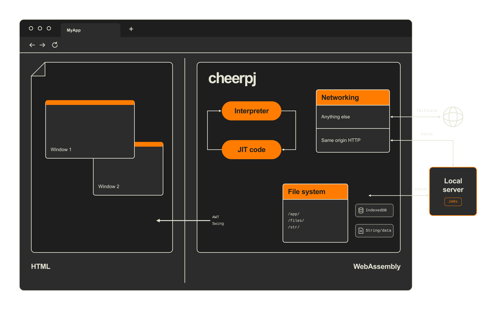

import { Icon } from "astro-icon/components";
import LinkButton from "@leaningtech/astro-theme/components/LinkButton.astro";
import { DISCORD_URL } from "@/consts.ts";

Today we are proud to release CheerpJ 5.0, the latest major release of CheerpJ, a full distribution of OpenJDK for the browser in WebAssembly, designed to run Java applications and libraries in the browser.

<div class="flex items-center gap-2 flex-wrap">
	<LinkButton
		type="primary"
		href="https://cheerpj.com/docs/getting-started"
		target="_blank"
		label="Get started"
		iconRight="mi:arrow-right"
	/>
	<LinkButton
		type="discord"
		href={DISCORD_URL}
		target="_blank"
		iconLeft="fa-brands:discord"
		label="Join us on Discord"
	/>
</div>

This release brings countless improvements, with the headline being support for Java 21 and 25. Together with Java 8, 11 and 17, which CheerpJ already supported, this completes the [roadmap](https://labs.leaningtech.com/blog/cheerpj-3.1) we first published in February 2025, whose goal was parity with the latest Java LTS by the end of 2026. CheerpJ 5.0 also now ships the full JDK, not just the JRE, for every supported version, making it possible to not just run, but also compile modern Java in the browser.

But, as strange as it might sound, modern Java is not the most impressive technical achievement in this release. CheerpJ 5.0 also includes **experimental support for a completely new execution engine based on WasmGC**. Stabilizing this engine will be our main focus over the next few months, and it will become production-ready with CheerpJ 6.0, in early 2027. We expect the WasmGC engine, together with several other lines of work, to make it practical to run large-scale modern Java applications in the browser, including modern versions of Minecraft and IntelliJ IDEA.

## How does CheerpJ work?

<figure class="w-full">
	
	<figcaption class="text-center">
		Diagram of the CheerpJ architecture, illustrating the main components.
	</figcaption>
</figure>

CheerpJ is a full JVM in WebAssembly, first released in 2017 and engineered from scratch to make Java a first-class language in the browser. Its current architecture, introduced with CheerpJ 3.0 in 2024, was rebuilt around a JIT compiler compiled to WebAssembly. This allowed us to remove preprocessing steps and greatly increase compatibility with real-world code.

Unlike other solutions, CheerpJ is not limited to Java code written specifically for the browser. From day one it was designed to run existing, large-scale Java applications fully unmodified. That means full support for reflection, runtime class generation, custom class loaders, multithreading and synchronization. CheerpJ works exclusively at the Java bytecode level, so source code is never required. Proprietary or legacy applications whose source code is not available work with CheerpJ too, and so do obfuscated JARs. And since CheerpJ runs bytecode, _any_ JVM language, including Kotlin and Scala, works out of the box.

Beyond the JVM itself, CheerpJ provides extensive emulation for capabilities that a browser does not natively offer, including multiple virtual file systems, networking, clipboard integration, audio, printing and window management. In some respects CheerpJ even goes beyond what a native JVM would do: Java desktop applications can run on phones and tablets, with touch input, even if the original code was never meant for such devices.

At a high level, CheerpJ is made of three building blocks:

- **A JVM and JIT compiler**, written in C++ and compiled to WebAssembly. Code starts in an interpreter and hot code is JIT-compiled, with optimizations such as inlining and devirtualization. In the default engine, the JIT generates JavaScript. In the new experimental WasmGC engine (see below), it generates WebAssembly.

- **A complete and unmodified build of OpenJDK** for every supported Java version. Everything is compiled from unmodified sources, including the entire JNI layer which is compiled to WebAssembly.

- **A virtualized system layer**, with file systems (assets over HTTP, persistent local storage in IndexedDB, data provided from JavaScript), networking via Tailscale, clipboard integration, and a window manager that supports multiple Java windows and applications on the same page.

For a closer look at the design, see the [deep dive](https://labs.leaningtech.com/blog/cheerpj-3-deep-dive) we published with CheerpJ 3.0, and the [architecture page](https://cheerpj.com/docs/explanation/architecture) in the documentation.

## What’s new in CheerpJ 5.0

This release includes more than six months of work across every component of CheerpJ. Here is a summary of what has changed.

### Support for modern Java (up to Java 25)

Running modern, large-scale Java applications in the browser is now a reality. CheerpJ has been very successful at preserving access to legacy, business-critical applications, Oracle Forms and E-Business Suite above all, and that work continues. With CheerpJ 5.0 we are building on that success to make CheerpJ a modern developer tool as well: in effect, an alternative JVM with a complete OpenJDK runtime, whose platform is the browser.

### The full JDK, not just the JRE

CheerpJ has always shipped only the JRE components of OpenJDK, to keep download size and initialization time down. After recent optimization work on our I/O logic we are now comfortable shipping the full JDK, for every supported Java version. This makes it possible not just to run Java in the browser, but also to _compile_ it: both `javac` and `jshell` can now run client-side. That opens up a whole new range of use cases, especially in education.

### Experimental support for WasmGC

Easily the largest rework since the JIT architecture was introduced in [CheerpJ 3.0](https://labs.leaningtech.com/blog/cheerpj-3-deep-dive). We have built a new, much faster interpreter and a second JIT backend that works entirely on the now-standard WebAssembly GC extension.

In the default engine, Java objects are JavaScript objects and hot code is compiled to JavaScript. In the WasmGC engine, Java objects become WasmGC objects and hot code is compiled into WebAssembly. Memory is still managed by the browser's garbage collector. We expect this to unlock significant performance improvements over the current stable engine, both at startup and at run time.

As an added bonus, WasmGC simplifies the interaction with complex native (JNI) libraries that are themselves compiled to Wasm. This matters, for example, for CheerpJ's support of [LWJGL](https://www.lwjgl.org/), a fundamental building block for Minecraft and many other games written in Java. CheerpJ supports LWJGL 2 today. Running LWJGL 3 was possible, but only with a large performance overhead, which made it impractical. We expect the WasmGC engine to sidestep these problems completely, paving the way for modern Minecraft and many other Java-based games.

As exciting as it is, the WasmGC engine is experimental and still unstable at this stage. We don't expect real-world applications to work just yet, but we welcome early testing from the community. It is opt-in:

```js
await cheerpjInit({ wasmGC: true });
```

The WasmGC engine requires a current browser: Chrome and Edge 137 or later, Firefox 153 or later, and Safari 27 or later (iOS and iPadOS 27 on mobile). There is no automatic fallback to the default engine yet, so please don't enable it in production. A stable WasmGC engine is the focus of CheerpJ 6.0, planned for early 2027.

### Many other bug fixes and improvements

Beyond the main new features listed above, this release also fixes several bugs, adds quality-of-life improvements and further optimizes startup and runtime performance.

**Stabilize support for Java 11 and 17:** Thanks to testing from the community and customers we are now confident CheerpJ can handle most applications for Java 11 and 17 out-of-the-box.

**General performance improvements:** Beyond the work on WasmGC, CheerpJ 5.0 also brings several performance improvements when using the stable engine. Parsing of class files has been sped up, the JIT engine has been fully re-tuned from first principles and downloading of JARs has been optimized.

**UI and mobile support:** Several improvements to Drag and Drop and clipboard integration, further improving cross-browser compatibility, and multiple additional fixes to mobile support, which was first introduced in the previous [CheerpJ 4.3 release](https://labs.leaningtech.com/blog/cheerpj-4.3).

## What can you run with CheerpJ?

In short, CheerpJ can run large-scale, modern Java desktop applications in the browser without modifications. We believe that a demo is worth a thousand words, so we have selected a few use cases for you.

## Large Swing apps, including custom Look & Feels

CheerpJ has fully support for GUI apps based on _Swing_ and _AWT_, including when a custom _Look & Feel_ is used. Multiple windows, clipboard integration and printing work as well. In most cases the an application will render exacly the same as it would when using a traditional desktop JVM.

The FlatLaf Demo, from the popular Look and Feel, is shown here running live in your browser. You can click around to see how components behave.

<figure class="breakout w-full aspect-video">
	<div id="demodivFlatLaf" class="w-full aspect-video relative">
		<iframe
			class="absolute w-full h-full focus:outline-hidden"
			src="https://leaningtech.github.io/cheerpj-example-flatlaf/"
		></iframe>
		<div id="demofullscreenFlatLaf">
			<Icon
				class="absolute right-0 bottom-0 w-8 h-8 m-1 text-stone-900 cursor-pointer"
				name="fa-solid:expand"
			/>
			<Icon
				class="absolute right-0 bottom-0 w-8 h-8 m-1 text-stone-900 cursor-pointer animate-ping opacity-50"
				style="animation-duration: 3s; "
				name="fa-solid:expand"
			/>
		</div>
		<div id="demonormalFlatLaf" class="hidden">
			<Icon
				class="absolute right-0 bottom-0 w-8 h-8 m-1 text-stone-900 cursor-pointer"
				name="fa-solid:compress-arrows-alt"
			/>
		</div>
	</div>
	<figcaption class="text-center">
		FlatLaf Look and Feel demo running in the browser with CheerpJ
	</figcaption>
</figure>

<script>{`
var demoDivFlatLaf = document.getElementById("demodivFlatLaf");
var demoFullscreenFlatLaf = document.getElementById("demofullscreenFlatLaf");
var demoNormalFlatLaf = document.getElementById("demonormalFlatLaf");
demoFullscreenFlatLaf.onclick = function()
{
	demoDivFlatLaf.requestFullscreen();
};
demoNormalFlatLaf.onclick = function()
{
	document.exitFullscreen();
};
demoDivFlatLaf.onfullscreenchange = function()
{
	if(document.fullscreenElement)
	{
		demoNormalFlatLaf.classList.remove("hidden");
		demoFullscreenFlatLaf.classList.add("hidden");
	}
	else
	{
		demoFullscreenFlatLaf.classList.remove("hidden");
		demoNormalFlatLaf.classList.add("hidden");
	}
};
`}</script>

_JavaFX_ and _SWT_ applications are not supported at this time, but these toolkit are in our pipeline. If you apps depends on them please get in touch, we might be able to share early previews.

## Demo: Unmodified Minecraft in the browser

[Browsercraft](https://browsercraft.cheerpj.com/), our web-based "embedding" of a historical Java version of Minecraft, continues to serve as one of our most demanding stress tests for CheerpJ. Unlike other approaches you may have seen, Browsercraft is not based on decompilation or reverse engineering. The original `client.jar` is fetched directly from Mojang's servers and runs completely unmodified in the browser. If you haven't tried it yet, it remains one of the best showcases of what CheerpJ is capable of.

<video class="breakout" controls autoplay loop muted playsinline>
	<source src="/blog/browsercraft4.mp4" type="video/mp4" />
</video>

Minecraft keeps being a critical validation tool for our technology. We believe that support for modern Java (in this release) and a stable WasmGC engine (planned for CheerpJ 6.0), will make it possible to run modern releases of Minecraft in the browser as well.

## Use Java logic directly from JavaScript

[Library Mode](https://cheerpj.com/docs/guides/library-mode) makes it possible to use Java libraries from JavaScript using a natural `async`/`await` based approach, with direct access to Java methods, objects, and arrays. On top of this, native method support allows [Java native methods](https://cheerpj.com/docs/guides/implementing-native-methods) to be implemented directly in JavaScript, similar to how JNI works on standard Java platforms. Together, these features enable a level of interoperability between Java and the browser that was simply not possible before.

The following snippet of code should give an idea of the capability of Library Mode. The code snippet is using the popular [iText](https://itextpdf.com/) Java library to generate a PDF completely client-side in the browser.

```js
async function iTextExample() {
	await cheerpjInit({ version: 17 });
	const lib = await cheerpjRunLibrary(
		"/app/jars/layout-9.8.0.jar:/app/jars/kernel-9.8.0.jar:/app/jars/io-9.8.0.jar:/app/jars/commons-9.8.0.jar:/app/jars/slf4j-api-2.0.17.jar"
	);
	try {
		const PdfWriter = await lib.com.itextpdf.kernel.pdf.PdfWriter;
		const PdfDocument = await lib.com.itextpdf.kernel.pdf.PdfDocument;
		const Document = await lib.com.itextpdf.layout.Document;
		const Paragraph = await lib.com.itextpdf.layout.element.Paragraph;
		const writer = await new PdfWriter("/files/HelloIText.pdf");
		const pdf = await new PdfDocument(writer);
		const document = await new Document(pdf);
		await document.add(await new Paragraph("Hello World!"));
		await document.close();
		const blob = await cjFileBlob("/files/HelloIText.pdf");
		const url = URL.createObjectURL(blob);
		pdfDisplay.data = url;
	} catch (e) {
		const IOException = await lib.java.io.IOException;
		if (e instanceof IOException) console.log("I/O error");
		else console.log("Unknown error: " + (await e.getMessage()));
	}
}
```

## Compile and run modern Java

{/* TODO: BrowserCode text */}

<figure class="breakout w-full aspect-video">
	<div id="demodivBrowserCode" class="w-full aspect-video relative">
		<iframe
			class="absolute w-full h-full focus:outline-hidden"
			src="https://browsercode.io/embed?runtime=cheerpj&framework=helloworld"
		></iframe>
	</div>
	<figcaption class="text-center">
		BrowserCode running in the browser with CheerpJ
	</figcaption>
</figure>

## What's next?

CheerpJ 5.0 completes our [roadmap](https://labs.leaningtech.com/blog/cheerpj-3.1) to bring modern Java to the browser, on schedule. Now we enter a new phase, focused on performance, on expanding the use cases CheerpJ supports, and on ease of use.

**Stabilize support for Java 25:** We consider Java 25 to be in preview, which means that we expect many small- and medium-scale use cases to work, but we also expect that small issues will need to be addressed when testing CheerpJ on very large apps. If something does not work for you, please let us know. Feedback from the community will be invaluable to reach a high level of stability for this feature.

**Production-ready WasmGC in CheerpJ 6.0:** WasmGC is available in this release as an opt-in, experimental feature, and we expect most real-world applications not to work with it just yet. CheerpJ 6.0, planned for early 2027, will make it production-ready. We will keep the current stable engine as the default for the foreseeable future.

**NPM support:** CheerpJ has always shipped as a plain JavaScript library, loaded from a CDN. This served us well while CheerpJ was mostly a tool to preserve access to legacy Java applications. Now that CheerpJ runs modern applications, we feel this model is no longer enough. We plan to make CheerpJ available as an NPM package and to modernize its interface.

**Maintaining Java LTS parity:** From now on, CheerpJ will maintain LTS parity with Java with a delay of at most six months. We want our users to be comfortable that CheerpJ won’t be a limiting factor in adopting the latest Java features when developing their applications.

**Integration with the BrowserPod kernel:** CheerpJ emulates a Linux system in the browser. The current implementation is robust, but fairly simplistic compared to the sophisticated WebAssembly kernel which is at the core of our other products: [CheerpX](https://cheerpx.io) and [BrowserPod](https://browserpod.io). We plan to rebuild the CheerpJ syscall layer on top of the same shared kernel, to achieve improved multi-processing support and much faster filesystem manipulation. In the future the integration will become even deeper, allowing x86 and WebAssembly native libraries and external programs to be used as part of Java applications running in CheerpJ, with every process sharing a unified view of the same virtual system.

## Licensing

CheerpJ is commercial software, with a free Community license for personal, educational and hobby use, for technical evaluation, and for individuals, one-person companies and non-commercial open-source projects.

With CheerpJ 5.0, commercial licensing is modeled after commercial OpenJDK distributions, and is based on who uses the application. **Desktop licenses** cover the Java applications your organization uses. **Application licenses** cover software you build with CheerpJ for customers or the public.

For small businesses and startups, straightforward and affordable licensing options are available. Enterprise licenses are available that allow self-hosting, redistribution and come with different levels of support.

Significant discounts are available for non-profit and educational institutions.

For details, see [Licensing](https://cheerpj.com/licensing/).

## Getting started

CheerpJ is extensively documented, from basic tutorials to the detailed API reference. Our [developer documentation](https://cheerpj.com/docs/getting-started) is the place to start.

{/* TODO: something about the agent skill */}

For questions, discussion and support, join us on [Discord](https://discord.leaningtech.com). It's an active community where Leaning Technologies developers and experienced users are on hand to help, and the perfect place to share and showcase what you build with CheerpJ.

<div class="flex items-center gap-2 flex-wrap">
	<LinkButton
		type="primary"
		href="https://cheerpj.com/docs/getting-started"
		target="_blank"
		label="Get started"
		iconRight="mi:arrow-right"
	/>
</div>
